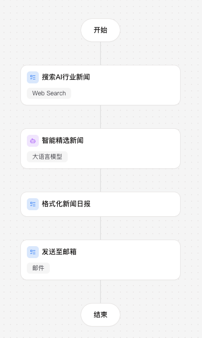

# AI Industry News Digest

[中文文档](README.zh-CN.md)

A [Coze Vibe Coding](https://code.coze.cn) project that runs a scheduled LangGraph workflow to fetch the latest AI-industry news, uses an LLM to pick the 3 most valuable stories, formats them into a readable daily digest, and emails it out.

**Live preview:** https://code.coze.cn/p/7689841331820036122/preview



## How it works

The workflow (`src/graphs/graph.py`) is a linear graph:

```
search_news_node → select_news_node → format_message_node → send_to_email_node → END
```

| Node | File | Type | Description |
|------|------|------|-------------|
| `search_news_node` | `src/graphs/nodes/search_news_node.py` | task | Web-searches the given topic for the latest news |
| `select_news_node` | `src/graphs/nodes/select_news_node.py` | agent | LLM picks the 3 most important stories and returns structured JSON (config: `config/select_news_llm_cfg.json`) |
| `format_message_node` | `src/graphs/nodes/format_message_node.py` | task | Formats the picked stories into digest text |
| `send_to_email_node` | `src/graphs/nodes/send_to_email_node.py` | task | Sends the digest by SMTP email |

A daily 8am trigger and final delivery are handled by the outer Coze platform scheduler/integration; this workflow just produces `digest_message` and emails it via SMTP.

See `CLAUDE.md` for a fuller architecture walkthrough and `AGENTS.md` for the platform-generated node manifest.

## Getting started

Requires Python >=3.12 and [`uv`](https://docs.astral.sh/uv/).

```bash
# install dependencies
bash scripts/setup.sh

# run the full workflow locally
bash scripts/local_run.sh -m flow

# run a single node
bash scripts/local_run.sh -m node -n search_news_node -i '{"topic": "AI"}'

# start the HTTP server
bash scripts/http_run.sh -p 5000
```

## Local run verification

The workflow was smoke-tested locally (macOS, `uv`-managed venv) on 2026-09-27:

- **Dependency install** — `bash scripts/setup.sh` succeeds. Note: `pycairo`, `dbus-python`, and `PyGObject` are inherited from the Coze devbox template and aren't imported anywhere in `src/`, but they still need system libraries to build; on macOS install them first: `brew install cairo pkg-config dbus glib gobject-introspection`.
- **App boot / graph wiring** — `COZE_WORKSPACE_PATH="$(pwd)" .venv/bin/python src/main.py -m flow -i '{"topic": "AI"}'` starts cleanly: logging, the APScheduler, and the LangGraph graph all initialize with no import or config errors.
- **Pure-logic node** — `format_message_node` runs correctly end-to-end without any external services, e.g.:
  ```bash
  COZE_WORKSPACE_PATH="$(pwd)" .venv/bin/python src/main.py -m node -n format_message_node \
    -i '{"top_news": [{"title": "Test AI News", "url": "https://example.com", "summary": "A short summary."}]}'
  ```
  produced:
  ```json
  {
    "digest_message": "AI 行业要闻早报 · 2026-09-27\n\n1. Test AI News\n   A short summary.\n   原文链接: https://example.com"
  }
  ```
- **Integration nodes** (`search_news_node`, `select_news_node`, `send_to_email_node`) **cannot run outside the Coze platform**: they call `coze_coding_dev_sdk.SearchClient`/`LLMClient` and `coze_workload_identity.Client`, which require a Coze-issued auth token. Running the full flow locally fails at `search_news_node` with:
  ```
  coze_coding_dev_sdk.core.exceptions.APIError: Search failed: {'Code': '190000007', 'Message': '... token validation failed: failed to parse token: token contains an invalid number of segments'}
  ```
  This is expected — full end-to-end runs (search → LLM select → email) require the Coze devbox/preview environment where these integration credentials are provisioned.

## Project structure

```
src/
  main.py              # FastAPI entrypoint (HTTP + CLI runner)
  graphs/               # LangGraph state, nodes, and graph definition
  storage/              # Postgres / checkpointer / S3 storage helpers
config/                 # Per-node LLM configs
scripts/                # setup / run / pack helpers
```
